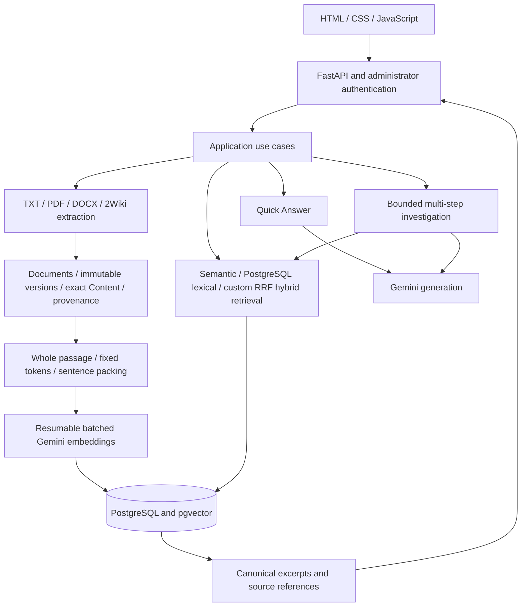

# AI Investigation Engine

> Correction (29 October 2026): The user explicitly confirmed automatic migrations. Normal container startup runs `alembic upgrade head` before starting the API and exits if migration fails. Explicit `--smoke` skips migrations. Earlier statements below describing removal/manual-only startup are superseded. Restoring this code does not execute a production migration.

An evidence-based investigation application built for the Upgaming Applied AI
Engineer assignment. Upload documents, retrieve passages, ask a quick question,
or let a bounded Gemini investigation make dependent searches before answering.
Answers link back to original excerpts and source locations. The system keeps
independent source identities even when their text is identical.

This goes beyond a basic document chat interface through immutable versioning,
resumable embedding persistence, controlled publication of searchable versions,
multiple retrieval channels, model-directed follow-up searches, explicit outcomes
and reproducible retrieval/answer evaluation.

## Architecture



Domain values are independent of SDK/database concerns. Application services own
workflow and budgets; infrastructure implements PostgreSQL, Gemini, extraction
and HTTP adapters. PostgreSQL stores authoritative documents and derived vectors
so transactions can protect version activation and deletion. Exact UTF-8 SHA-256
reuse includes exact-text verification; similar text is not semantically merged.
Whole-passage chunking fits the short dataset passages, while fixed-token and
sentence-aware alternatives retain offsets for longer documents.

Semantic search uses exact pgvector ranking. Lexical retrieval supports native
PostgreSQL full-text search and the existing optional `pg_textsearch` BM25 backend;
hybrid search combines channels using application-owned Reciprocal Rank Fusion.
These are configurations, not a claim that hybrid always beats semantic search.
No ANN/HNSW index or additional vector database is introduced by this milestone.

Quick Answer retrieves bounded evidence before a single generation. Investigation
can search again using information returned by earlier searches, with stable
server-assigned evidence IDs and bounded turns, context, searches, embeddings and
generation. Its outcomes distinguish an answer, insufficient evidence, conflicting
evidence and an incomplete execution. Quick Answer has the narrower answer/
insufficient-evidence contract and can describe disagreements in cited text.
Citation validation checks structure and authorized references; it does not prove
semantic entailment or establish that two people sharing a name are the same.

Document management uses an HTTPS-only administrator bearer token. Uploads,
updates, indexing and soft deletion preserve ownership and original provenance.
Private documents are excluded from anonymous/shared retrieval. Temporary upload
files are ephemeral; durable documents and embeddings remain in PostgreSQL.

## Setup and run

Use Python 3.14 and uv. Commands below run from the repository root:

```powershell
uv sync --locked --group dev
if (-not (Test-Path .env)) { Copy-Item .env.example .env }
```

Populate the ignored `.env`; do not commit credentials. See `.env.example` for
all bounds and switches. Development database commands use the existing Cloud
SQL Auth Proxy at `127.0.0.1:15432`. Cloud Run uses
`DB_CONNECTION_MODE=cloudsql_socket`, `DB_HOST=/cloudsql/PROJECT:REGION:INSTANCE`
and port 5432. There is no automatic fallback between databases.

Set `GEMINI_API_KEY`, an explicit available `GEMINI_GENERATION_MODEL`, and an
existing `SERVING_CHUNKING_CONFIGURATION_ID` before starting the real API.
Production was inspected using `gemini-3.5-flash-lite` on 29 October 2026; model
availability and quota are account-dependent. This is not a change to defaults.
Load the existing pinned tokenizer for indexing, or explicitly download and
checksum-verify its public artifact:

```powershell
uv run python -m investigation_engine.infrastructure.tokenization.fetch_runtime artifacts/tokenizers/voyage-4/tokenizer.json
```

The database needs PostgreSQL 18 and pgvector 0.8.5 for the current test baseline.
Before applying migrations, inspect the intended database, review compatibility
and backups, and provision required extensions with an operator identity.
`pg_textsearch` is required for BM25; fallback full-text search is separate.
For a reviewed target only:

```powershell
uv run alembic current
uv run alembic upgrade head
uv run python -m investigation_engine.infrastructure.api.server
```

Migrations are explicit operator work, never ordinary API startup. The current
chain includes canonical search chunks and optional BM25 indexing in migrations
0003/0004. Do not apply it to production just to run tests. `/health` is process
liveness; production lifespan validates the configured serving profile.

For a credential-free UI/packaging check, run with `--smoke`. Questions and
management deliberately return unavailable in this explicit mode.

## Tests and quality checks

```powershell
uv run ruff format --check src tests scripts deploy migrations
uv run ruff check src tests scripts deploy migrations
uv run pytest tests/unit -q
docker build -f deploy/Dockerfile.postgres-test -t investigation-postgres-test:local .
uv run pytest tests/integration -q
node --test tests/frontend/test_web.cjs
```

The disposable test image pins PostgreSQL/pgvector and installs a checksum-pinned
pg_textsearch release. Tests cannot fall back to application credentials or a
production database. The former explicit external test-database override was
removed. Dataset/live-provider tests are opt-in and are reported separately.
See the [consolidated report](docs/validation/submission-evaluation.md) for current
results and earlier failed attempts; historical test counts are not current runs.

## Containers and deployment

```powershell
docker build --target runtime -t ai-investigation-engine:local .
```

In Bash (Git Bash on Windows):

```bash
bash deploy/smoke_image.sh ai-investigation-engine:local
```

The image uses locked production dependencies, a non-root UID, one Uvicorn
process, `0.0.0.0:$PORT`, ephemeral temporary files and graceful SIGTERM handling.
The existing Cloud Run service and GitHub main trigger are reused. Cloud Build
runs required checks before publishing a commit-tagged image and deploying its
immutable digest. No schema migration runs in CI or API startup.

The trigger's inline deployment path was replaced with `cloudbuild.yaml` on
29 October. **A successful push-triggered execution of the new gates is still
unverified.** Changes in this checkout have not been committed or pushed by
Codex. The current runtime is public and uses plaintext secret environment
variables; the prepared deployment preflight rejects these settings. Secret
Manager references, invocation protection/aggregate quota controls and scoped
build IAM still need operator attention before activation. Existing runtime
settings were not altered to bypass those checks.

See the [deployment guide](docs/design/cloud-run-deployment.md) for exact resource
IDs, environment settings, IAM, test-container networking, verification, costs
and rollback. No new cloud service, database or billing setting was introduced.

## Dataset and measured evidence

| Scope | Recorded size and meaning |
| --- | --- |
| Pinned 2Wiki development processing | 125,760 source occurrences; 56,680 unique exact Contents |
| Complete processing experiment | Registration and chunk plans; not proof of a fully embedded corpus |
| Attested persistent local evaluation database | 218 documents/versions, 197 Contents and real 768-dimensional Gemini vectors, 218 active searchable versions |
| Frozen question suite | 40 questions across simple, two-hop, bridge comparison, unanswerable and contradiction categories |

These counts describe different experiments. Later cloud retrieval experiments
are preserved separately; neither the processing count nor the local evaluation
count implies all 125,760 occurrences have been embedded.

The historical real-embedding baseline reported Recall@5 0.875, Recall@10 0.9265,
Recall@20 0.9412, MRR@20 0.9853 and complete support coverage@20 0.8235. Semantic
and hybrid had identical measured coverage on that local corpus; only four of
eight bridge comparisons had all supporting evidence at K=20. Answer quality
and source support are evaluated separately from retrieval.

See the [submission evaluation report](docs/validation/submission-evaluation.md)
for the latest paired real-model run, per-category metrics, usage, failures and
limitations. Frozen gold labels never enter searchable documents or model input.
Previously inspected development questions are not an unseen held-out benchmark.

## Limitations

- Structural citations do not guarantee factual support; entity ambiguity and
  unsupported inference remain model-dependent. Prompt guidance is not a verifier.
- Missing retrieval facts can cause correct abstention relative to context but an
  incorrect abstention relative to the question. Quick Answer cannot perform
  dependent follow-up planning; investigation costs additional calls and latency.
- Per-request bounds and one Cloud Run instance do not provide an aggregate public
  Gemini quota budget. Public access needs operational protection.
- Foreground investigations and provider-native conversation state are not durable
  jobs; instance termination can interrupt them.
- Provider availability, project quotas and already-consumed quota limit reproducible
  live evaluation. Real failures are retained, not retried until successful.
- Full account management, background indexing/recovery and production load testing
  remain outside this implementation. PDF extraction has no OCR.

Detailed references: [documentation index](docs/README.md),
[decision register](docs/decisions/register.md),
[document lifecycle](docs/design/document-lifecycle-and-indexing.md),
[AI usage](AI_USAGE.md).
